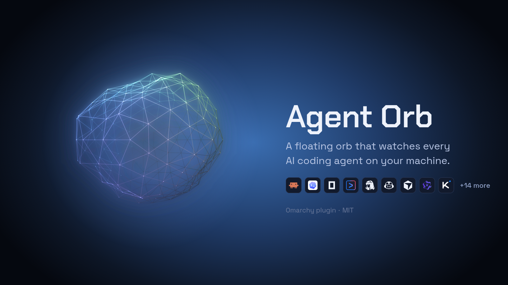

<h1 align="center">Agent Orb</h1>

<p align="center">A floating orb that shows when your AI coding agents are working.</p>

<p align="center"></p>

## What it does

A floating wireframe orb for [Omarchy](https://omarchy.org) that watches every AI
coding agent session on the machine and reacts when one of them is working.

- Watches 23 coding agents, auto-detected, and picks up agents you install later without a restart
- The orb swells when an agent starts working
- Colours come from the active Omarchy theme, so it follows `omarchy theme set`
- Pairs with [`OmarchyAgentOrbStatus`](https://github.com/macd2/OmarchyAgentOrbStatus), a pixel-art version for the status bar

## Install

```bash
omarchy plugin add https://github.com/macd2/OmarchyAgentOrb --enable
```

That clones the repo into `~/.config/omarchy/plugins/io.github.macd2.agent-orb` as a git
checkout, so updates are just:

```bash
omarchy plugin update io.github.macd2.agent-orb
```

Prefer to copy the folder yourself, or to symlink it while editing?

```bash
git clone https://github.com/macd2/OmarchyAgentOrb
cd OmarchyAgentOrb
./scripts/install.sh            # copy
./scripts/install.sh --watch    # symlink, hot reloads on save
./scripts/install.sh --remove   # uninstall
```

## Agents

`watcher/agent-watch.js` is a single Node process (libuv `fs.watch`, recursive,
no child processes) that watches the session directories of 23 agents:

opencode · claude · codex · **hermes** · **pi** · gemini · antigravity · qwen ·
kimi · grok · copilot · goose · crush · aider · amp · cursor · kilocode ·
continue · openhands · plandex · vibe · junie · openclaw

Sources are data, auto-detected, and re-checked every 15 s, so an agent you
install later is picked up without a restart.

### Adding your own

Don't edit the watcher — it takes overrides:

```bash
# ~/.config/omarchy/agent-watch/sources.json
{
  "extra": [
    { "id": "myagent", "label": "My Agent", "dirs": ["~/.myagent/sessions"] }
  ]
}
```

or ad-hoc:

```bash
AGENT_ORB_SOURCES="myagent=~/.myagent/sessions" omarchy restart shell
```

Each source lists candidate directories in priority order and attaches to the
first that exists, so a narrow session directory beats a noisy agent home.

## Requirements

- Omarchy with `omarchy-shell` (uses `qs.Commons` for theming)
- Node 20+ for **recursive** `fs.watch` on Linux — Node 18 silently degrades to
  top-level-only watching and misses per-project subdirectories
- `jq`, for `scripts/install.sh` only

## If something looks wrong

- **Agents working in nested project folders are not picked up.** Node 18
  silently degrades `fs.watch` to top-level-only watching and misses
  per-project subdirectories. Install Node 20+.

## How it works

The mesh is a noise-displaced icosahedron with a 4-colour iridescent gradient,
rasterised with Canvas 2D so it runs on software GL. Colours come from the
active Omarchy theme, so it follows `omarchy theme set`.

### What counts as "working"

Naive file watching is useless here. Profiling opencode for 60 s showed **60 of
66 events were `opencode.db-wal`** — SQLite checkpoints that fire regardless of
activity — so a naive watcher pins the orb permanently in motion.

A second 45 s profile showed those sidecar writes are actually *bursty*: 0/sec
while idle, 3–34/sec while genuinely working. So they are the best signal
available and are **not** filtered. `busy` instead requires either a real
(non-sidecar) file within 2.5 s, or a burst of 3+ events within 1.5 s.

Measured: **91 % busy while working, 0 % while idle.**

The orb's impulse fires on the *rising edge* of that signal, so one burst
produces one swell rather than thirty-four.

### Files

| Path | |
|---|---|
| `manifest.json` | plugin contract; validated by `omarchy plugin validate` |
| `Main.qml` | `PanelWindow`, icosphere, noise, theme colours |
| `watcher/agent-watch.js` | the watcher |
| `watcher/agent-watcher.sh` | `exec` launcher, so the shell supervises the watcher directly |
| `scripts/install.sh` | manual install; not needed for `omarchy plugin add` |

## Companion: the bar widget

[`OmarchyAgentOrbStatus`](https://github.com/macd2/OmarchyAgentOrbStatus) is a
pixel-art version of the same orb for the status bar — a 23 px sprite, ordered
Bayer dithering, and one band per active agent. Separate plugin, separate
install, shared watcher and state file.

## Remove

```bash
omarchy plugin remove io.github.macd2.agent-orb
```

That deletes the plugin, disables it and reloads the shell. The watcher is a
child of the shell process, so it exits with it — nothing is left running.

Optional, if you also want the shared state gone. Both plugins use it, so
remove the other one first:

```bash
rm -rf ~/.local/state/omarchy/agent-watch
```

Nothing outside those two directories is touched. This plugin writes no
configuration of its own; the only file it reads is the optional
`~/.config/omarchy/agent-watch/sources.json`, which is safe to delete.

## License

MIT
